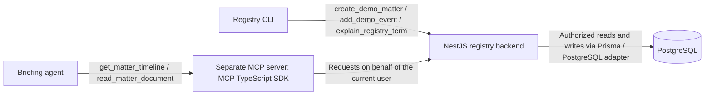

# Legal Registry & Matter Briefing Agent

This standalone TypeScript project supports the developer's personal learning by
modeling a small legal registry and an agent that produces evidence-backed
matter briefings. All firms, parties, documents, and court sessions are fictional.

The **developer** builds the project. A **registry user** operates the application
through its command-line interface, the **Registry CLI**. Access-control
descriptions use **current user** for the identity whose access the backend checks.

## Components and responsibilities

- **Registry CLI:** Lets a registry user call the NestJS registry backend for
  three operations: `create_demo_matter` creates a fictional matter,
  `add_demo_event` adds a fictional event to a selected matter, and
  `explain_registry_term` explains registry vocabulary in plain language.
- **Registry backend:** Uses NestJS for the registry API and Prisma Client with
  the PostgreSQL adapter (`@prisma/adapter-pg`) for persistence. It owns validation
  and access checks. Only this component accesses PostgreSQL. For every
  matter-scoped request, including Registry CLI writes and MCP reads, it checks
  that the current user has access to the selected matter before returning or
  changing records.
- **MCP server:** Runs separately from the backend and uses the MCP TypeScript
  SDK. It exposes exactly two tools: `get_matter_timeline` and
  `read_matter_document`. These tools are read-only. The server requests records
  from the backend on behalf of the current user, preserving that user's
  identity for authorization; it does not access PostgreSQL directly.
- **Briefing agent:** Uses those two MCP tools to read the timeline and source
  documents, distinguish confirmed facts from uncertainty, and cite exact source
  versions in its briefing. It cannot create or modify registry records.
- **PostgreSQL:** Stores matters, parties, events, documents, document versions,
  and the access records used by the backend.

## Configuration ownership

The project developer normally applies configuration changes personally,
including credentials, databases, ports, volumes, environment variables, and
Prisma connections. Discuss the choice, provide Ubuntu WSL commands or precise
file edits, explain the expected result, and show how to verify it. Codex can
apply configuration changes only when the developer explicitly delegates that
specific task, as with Prisma setup. Never request or print the developer's
password or full connection URL.

## Document versions and reopening citations

A document-version read must pass the matter access check and verify that the
requested version belongs to the requested document and selected matter. A
version identifier alone is never enough to authorize a read.

Each citation identifies the matter, document, and exact version supporting its
claim. Reopening a citation uses `read_matter_document` and the backend's same
access and ownership checks, even if the registry user previously read the
source. It must retrieve the cited version rather than silently substituting
the latest version. The registry user reopens every citation and checks the
claim against that source.

## Milestone order

1. **Model the matter:** Define matters, parties, events, documents, immutable
   source versions, and registry user access relationships using fictional
   fixtures.
2. **Build the registry API:** Implement the NestJS backend and Registry CLI
   operations, PostgreSQL persistence, and matter and version checks.
3. **Expose the read-only MCP tools:** Build the separate TypeScript SDK server
   with only `get_matter_timeline` and `read_matter_document`, delegating all
   record access and authorization to the backend.
4. **Add and evaluate the agent:** Produce cited briefings and evaluate them
   against the two-run scenario in
   [ALA-DEMO-001 acceptance](../fixtures/matters/ALA-DEMO-001/acceptance.md),
   including exact-version citation reopening.
